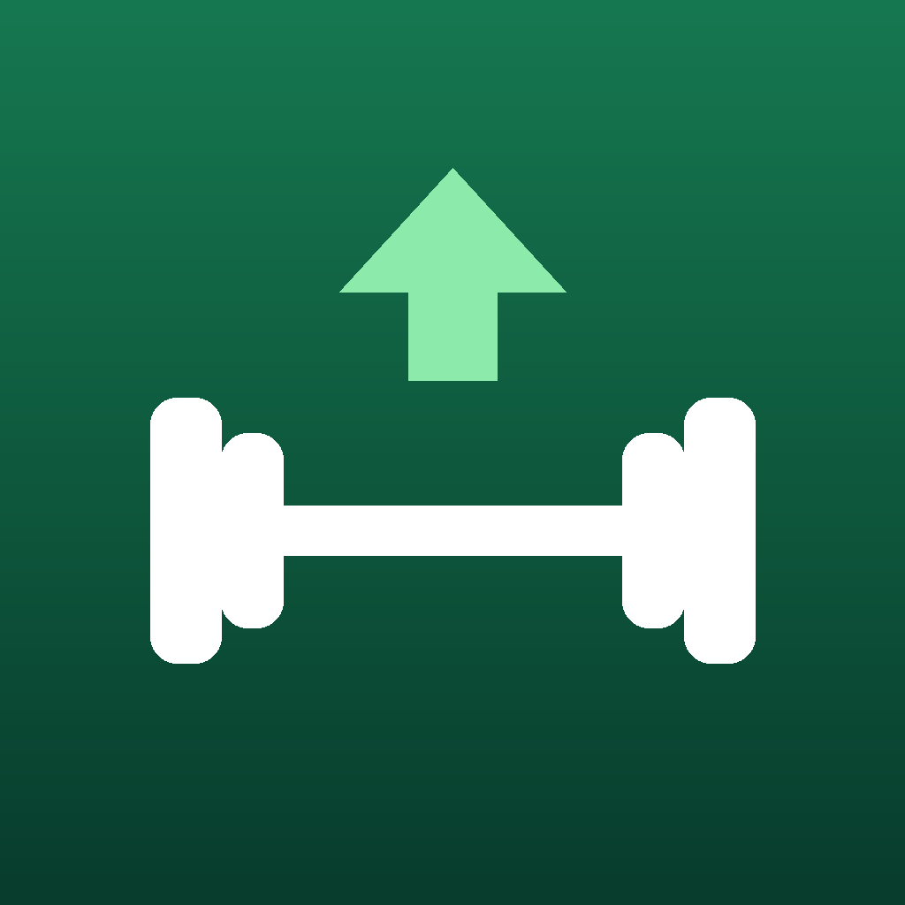

<p align="center">
  
</p>

<h1 align="center">LiftNote · 练记</h1>

<p align="center">
  A routine-free strength-training journal for iPhone, built around weekly set volume, per-set quality and real gym equipment.
</p>

<p align="center">
  <a href="https://github.com/richardB520/liftnote_1/actions/workflows/ci.yml"></a>
  
  
  <a href="LICENSE"></a>
</p>

<p align="center">English · <a href="README.zh-CN.md">中文</a></p>

---

## Why

Most workout loggers (Hevy, Strong, …) are built around fixed routines. In a busy gym you rarely get to follow one: the machine is taken, so you switch to another brand's version, and next time you start from whatever you did *last time for that muscle*. LiftNote is designed for that workflow:

- **No routines.** Pick today's muscle groups; each group's exercises are carried over from its most recent session, sets are pre-created and the last weight × reps is shown next to every set.
- **Volume first.** The goal is 10–20 *working* sets per muscle per week (configurable). Warm-ups and unfinished sets never count, and a set only counts for the muscles a movement trains *directly*.
- **Quality ≠ load.** Each set can be marked ↑ / → / ↓ for execution quality versus last time, independent of weight or rep changes, so "same weight, cleaner reps" is captured before progressive overload shows up.
- **Real equipment.** Brand and series matter: a Hammer Strength row and a PRIME row have separate histories. PRIME plate-loaded machines record plates per horn position (1 / 2 / 3).
- **No calorie estimates.** They are inaccurate, so the app doesn't show them.

## Features

| | |
| --- | --- |
| **Logging** | Templates from last session per muscle group · swap equipment mid-workout (finished sets stay with the original machine) · warm-up sets · edit/delete any set · discard a workout · auto title follows what you actually trained |
| **Equipment** | 147 built-in entries: Nautilus, PRIME (plate-loaded with 3 horn positions + selectorized), Atlantis, Hammer Strength (Plate-Loaded, Select, MTS), free weights and cables · brand / kind / muscle filters · Chinese search · custom equipment |
| **Single / both arms** | Toggle for every back exercise and for arm & shoulder cable exercises; separate history and separate rest time |
| **Rest timer** | Countdown next to the set, in the workout header, on the Lock Screen and Dynamic Island (Live Activity), plus a local notification when it ends · per-exercise overrides |
| **Voice logging (Chinese)** | Say *"诺德士坐姿胸推，45 公斤，两组，第一组 10 次，第二组 8 次，都比上次轻松"* → editable confirmation card. Handles pauses, Chinese numerals, common mis-hearings, per-set vs. all-set quality, PRIME horn positions, "same as last set", and "save now, fill in later" |
| **Weekly volume** | Front/back body map, 7 progress bars against the target band, tap a muscle to see exactly which sets counted, 6-week trend grid |
| **History** | Editable table per workout (sets, date, title, notes, **change mis-logged equipment**) · notebook view comparing the same machine across sessions side by side · add a forgotten workout |
| **Data** | Local-only, offline, draft auto-restore · JSON backup export / merge-import that never overwrites newer local edits |

Muscle groups: chest · back · quads (腿前侧) · hamstrings & glutes (腿后侧) · biceps · triceps · side delts. Front and rear delts are intentionally not tracked.

## Reusable core library

`LiftNoteCore` (`LiftNote/Core`) is a Foundation-only Swift package that builds and tests on **macOS and Linux**:

- `VoiceParser` – turns free-form Chinese gym speech into structured sets (Chinese numerals with context-aware conversion, weight-to-set assignment rules, quality scope, plate positions, equipment matching with brand/kind disambiguation).
- `TranscriptAccumulator` – merges streaming speech-recognition results across pauses without duplicating or overwriting text.
- `WeeklyVolume`, template building, equipment-swap and history-edit logic, backup merge.

```swift
.package(url: "https://github.com/richardB520/liftnote_1.git", branch: "main")
// then depend on the "LiftNoteCore" product
```

## Getting started

```bash
git clone https://github.com/richardB520/liftnote_1.git
cd liftnote_1
swift test                  # core tests (macOS or Linux)
open LiftNote.xcodeproj     # Xcode 16+, iOS 17+
```

To run on a device, select your team for both the **LiftNote** and **LiftNoteWidgetsExtension** targets. If the bundle identifier is taken, change the single `LIFTNOTE_BUNDLE_ID` build setting on the project. Step-by-step instructions (in Chinese) are in [README.zh-CN.md](README.zh-CN.md#装到-iphone-上).

## Project layout

```
LiftNote/Core        domain logic, Foundation only (SwiftPM target LiftNoteCore)
LiftNote/App         app entry, persistence, speech recognition, notifications, Live Activity control
LiftNote/Views       SwiftUI screens
LiftNote/Shared      ActivityAttributes shared with the widget
LiftNoteWidgets      Lock Screen / Dynamic Island rest timer
Tests/               unit tests (run by both SwiftPM and Xcode)
tools/               Xcode project generator, icon generator
docs/                architecture notes
```

## Roadmap

- [ ] English localization
- [ ] Read workouts from WHOOP (the public API is read-only; remote start/stop isn't possible)
- [ ] Apple Health export of workout sessions (no calorie estimates)
- [ ] Per-muscle custom weekly targets and deload weeks
- [ ] iCloud sync between devices
- [ ] More equipment brands (Life Fitness, Panatta, Gym80, Technogym …), contributions welcome

## Status

Early (`0.x`). The core library is covered by unit tests and CI builds the iOS app on every push. Expect breaking changes before 1.0. See [CHANGELOG.md](CHANGELOG.md).

## Contributing

Bug reports, voice transcripts that parse wrong, and equipment additions are especially welcome. See [CONTRIBUTING.md](CONTRIBUTING.md) and the [Code of Conduct](CODE_OF_CONDUCT.md). Security issues: [SECURITY.md](SECURITY.md).

## License

[MIT](LICENSE)
